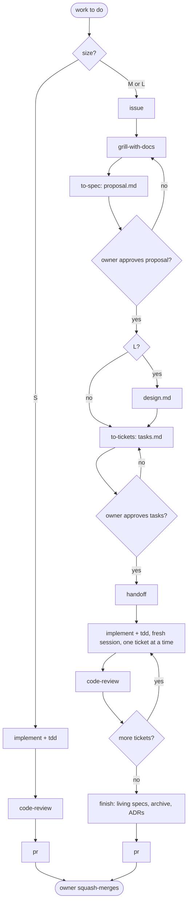
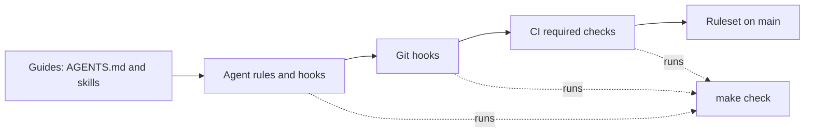
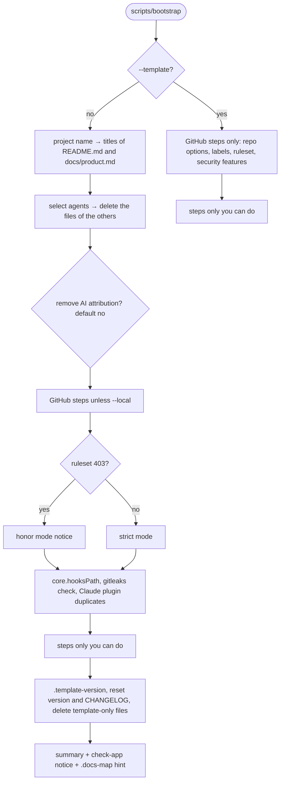

# solo-harness

<!-- solo-harness:template-only:start -->
A GitHub template for one developer who works with AI coding agents. It gives every new project a development process that tools enforce, not prompts: agents work from short specs in small, test-first steps, every merge passes deterministic checks, and the documentation stays current.

The template is language-agnostic. It supports four agents (Claude Code, Codex CLI, GitHub Copilot and Antigravity CLI) from one `AGENTS.md` and one skills folder. It is built for a small budget: a Claude Pro plan and GitHub Free. No MCP servers, a short `AGENTS.md`, hooks that print only failures, and no AI in CI.

## Quick start

1. On GitHub, click **Use this template** and create your repo. Clone it.
2. Install `bash` 4 or later, `git`, `make`, `python3` and `gh`, then run `gh auth login`.
3. Run `scripts/bootstrap`. It asks for the project name, the agents you use, and whether agents may add AI attribution to commits and PRs. Then it configures the GitHub repo and your clone.
4. Do the steps that the summary lists under "Steps only you can do".
5. Fill the `check-app` target in the `Makefile` (see [Stack overlays](#stack-overlays)).
6. Run `make check`. Then start your first change with your agent.

Use `scripts/bootstrap --dry-run` first to see every action without a change, or `--local` to skip GitHub. [Bootstrap](#bootstrap) has the details.
<!-- solo-harness:template-only:end -->

This project uses the solo-harness workflow: one owner, one main agent, small test-first steps. This README explains that workflow. `AGENTS.md` is the short version that the agents read.

## Lifecycle and change sizes

Every unit of work is a **change** with a size. The agent proposes the size; the owner confirms it.

| Size | When | Path |
|---|---|---|
| **S** | No new or changed requirement: a bugfix, chore, refactor, docs or dependency bump | (optional issue) → `implement` + `tdd` → `code-review` → `pr` |
| **M** | New or changed behaviour inside one capability | issue → `grill-with-docs` → `to-spec` → owner approves the proposal → `to-tickets` → owner approves the tasks → `handoff` → `implement` + `tdd` in a fresh session → `code-review` → `finish` → `pr` |
| **L** | Spans capabilities, or makes a hard-to-reverse choice | As M, plus `design.md` and an ADR |



**Where the files go.** An M or L change has a change folder `specs/changes/<issue>-<slug>/` with `proposal.md` (what and why, with criteria `AC-<issue>-<n>`), `tasks.md` (tickets) and, for L, `design.md` (how). `specs/<capability>.md` describes the current behaviour of each capability. `finish` applies the proposal to those living specs and moves the change folder to `specs/changes/archive/YYYY-MM-DD-<issue>-<slug>/`.

**Tests name their criterion.** The first line of each test is a comment such as `# AC-12-3`. `docs-gate` uses these comments to prove that every criterion of an M or L change has a test.

**Review once.** `code-review` runs once at the end of every ticket and before every PR, for every size. It runs two read-only reviewers in parallel: one checks the repo standards, one checks the spec. After its findings are fixed, it does not run again unless the owner asks. Repeated passes always find something, and the value drops with each pass.

**`finish`** is the last commit inside an M or L PR. It checks that every task is ticked and every criterion has a test, updates the living specs, archives the change folder, asks the owner about each decision that needs an ADR and writes it, and reports the release bump that the PR title implies. It never edits `CHANGELOG.md` and never merges.

**Skills.** The skills live in `.agents/skills/` (see `.agents/skills/VENDORED.md` for the source and pinned commit of each). Text that one agent writes for another, such as handoffs and review findings, uses the `asd-ste100` skill (Simplified Technical English) in strict mode.

**Models.** Advice only: plan with the strongest model, implement with the default one. No agent config pins a model.

## Enforcement layers

Prompts advise; exit codes enforce. Each layer below catches what the layer before it misses, so no single layer has to be perfect.



| Layer | Where | What it does |
|---|---|---|
| Guides | `AGENTS.md`, `.agents/skills/` | Tell the agent the process. Advisory only. |
| Agent rules | `.claude/settings.json`, `.codex/rules/default.rules` | Deny pushes to `main`, force pushes, merges, `--no-verify`, reading `.env*` and `~/.ssh`, and edits to agent policy files and `.githooks/`. Ask before edits to workflows, the `Makefile` and `.harness/tools.lock`, and before package installs. |
| Agent hooks | `.harness/hooks/` | `guard-bash.sh` blocks shell commands that the rules miss. `fmt.sh` formats each edited file. `stop-check.sh` runs `make check` when the agent stops with uncommitted changes. Codex, Copilot and Antigravity run them through `adapter.sh`. All are silent on success. |
| Git hooks | `.githooks/` | `pre-commit` runs `make check` and `gitleaks`. `commit-msg` rejects messages that are not Conventional Commits. |
| CI | `.github/workflows/ci.yml` | Required checks on every PR: `check`, `pr-title`, `zizmor`, `secrets`, `deps`, `pr-size`, `docs-gate`, `test-oracle`. `ste-lint` reports on the PR body and never blocks. |
| Ruleset | `.github/ruleset.json` | `main` takes changes only through a PR with all required checks green: linear history, squash merges, resolved review threads, no force push, no deletion. The bypass list is empty, so the owner follows the same rules. Zero approvals are required: the owner's merge is the approval. |

**`make check`** is the one verification command: `check-harness` (the harness's own lints and tests) plus `check-app` (the project's checks). Agents, git hooks and CI all run it, so a green local run means a green `check` job.

**`docs-gate`** reads the PR-body fields `Size:`, `Change:`, `ADR:` and the optional `Docs: unchanged – <reason>`. An S PR fails over 150 changed lines (lockfiles excluded) or when it changes a living spec, unless it has the label `size-exception`. An M or L PR must add its archived change folder with every task ticked, modify a living spec, and have a test for every criterion. `.docs-map` maps code globs to the docs they need (`src/api/** -> docs/api.md`); it ships empty.

**`test-oracle`** fails a PR that changes tests, snapshots, workflows, CI config or pinned tools without a change under `specs/`. A change to what counts as correct needs a spec change that says why.

**Pinned tools.** `make tools` installs `shellcheck`, `actionlint`, `gitleaks` and `osv-scanner` into `.harness/bin/` from `.harness/tools.lock`, and refuses a download whose SHA-256 does not match. `scripts/install-tools --update <name|all>` moves a pin; the monthly `tools-outdated` workflow opens an issue when a pin is stale.

**Limits.** `guard-bash.sh` reads the command text. It cannot see commands that the shell builds at run time, such as `$(echo git) push`. It is a backstop for the agent rules, not a sandbox. The git hooks, CI and the ruleset hold when it misses.

## Bootstrap

`scripts/bootstrap` turns a copy of the template into a configured project. It is idempotent: each step checks the current state first and prints `ok` or one `changed` line per change, so you can run it again at any time.



| Command | What it does |
|---|---|
| `scripts/bootstrap` | Set up this project. Safe to run again. |
| `scripts/bootstrap --dry-run` | Print every action and every `gh api` call. Change nothing. GitHub reads still run. |
| `scripts/bootstrap --local` | Skip all GitHub steps. |
| `scripts/bootstrap --template` | For the template repo itself: GitHub steps only. Never deletes or rewrites a file. |
| `scripts/bootstrap --add-agent <name>` | Add one agent (`claude`, `codex`, `copilot` or `antigravity`) to an existing project. |

**GitHub steps** need `gh`, logged in, in a clone with a GitHub remote. They set the repo options (squash merge only, delete branches on merge, PR title as the squash commit title and the commit list as its message), create the labels `size/S`, `size/M`, `size/L`, `size-exception`, `agent` and `dependencies`, apply `.github/ruleset.json`, and on a public repo turn on CodeQL and secret-scanning push protection.

**Template-only content.** The first project run deletes the paths in `.template-only` and the parts of this README between the `solo-harness:template-only` start and end markers. It also starts the project at version `0.1.0` with an empty `CHANGELOG.md`.

**`.template-version`.** The first project run writes this file with three keys:

- `repo=<owner>/<name>`: the template repo. Bootstrap reads it from GitHub for a repo made with "Use this template". For a clone, a fork or `--local`, it uses `TEMPLATE_REPO` in `.harness/config`.
- `version=<version>`: the template version that the project started from (`version.txt` of the template).
- `agents=<list>`: the agents you selected, comma-separated. A re-run uses this list as the default answer.

A re-run keeps the stored repo and version.

**`--add-agent <name>`** downloads the template repo at the tag `v<version>` from `.template-version`, and copies only that agent's files. Then it asks the attribution question for that agent, runs the Claude plugin check, adds the agent to `agents=` and prints the agent's trust step. It stops before any change if a file of that agent already exists. It cannot run with `--template` or `--local`.

**Release tags** are `v<version>` (`include-component-in-tag: false` in `release-please-config.json`). Keep this format: `--add-agent` depends on it.

**A fork as your own template.** Change `TEMPLATE_REPO` in `.harness/config` to your fork, tag your releases `v<version>`, and mark the fork as a template on GitHub. Projects made from it then add agents from your fork.

**Trust steps.** Each agent loads project hooks only after you trust the project. Bootstrap prints the step for each selected agent: start Claude Code in the folder and trust it; in Codex, trust the project and each hook with `/hooks` (again after a hook changes); for Antigravity, add the folder to `trustedWorkspaces`.

## Strict and honor mode

Bootstrap applies the ruleset. On a public repo, or on a paid GitHub plan, GitHub enforces it: this is **strict mode**. On a private repo on GitHub Free, GitHub refuses the ruleset with HTTP 403. Bootstrap then prints that the repo runs in **honor mode**: CI still runs and reports, and the agent rules still forbid merging and pushing to `main`, but GitHub does not block a merge. Merging is then the owner's decision.

Other GitHub Free limits on private repos:

| Feature | Public repo | Private repo on GitHub Free |
|---|---|---|
| Ruleset on `main` | Enforced | Not available (honor mode) |
| `deps` check | `dependency-review-action` | `osv-scanner` (dependency review needs GitHub Advanced Security) |
| CodeQL code scanning | Turned on by bootstrap | Not available |
| Secret-scanning push protection | Turned on by bootstrap | Not available; the `secrets` CI check and the `gitleaks` pre-commit hook still run |

To move to strict mode later, make the repo public or change the plan, then run `scripts/bootstrap` again.

## Sandbox

The Claude Code OS sandbox is off by default. To turn it on, set this in `.claude/settings.json`:

```json
"sandbox": {
  "enabled": true
}
```

Agents cannot edit `.claude/settings*.json` (a deny rule), so make this change yourself. See the Claude Code sandbox documentation for the platform requirements.

## Stack overlays

The core knows no language. An overlay adds one stack (for example TypeScript or Python). To write one:

1. **Fill `check-app`.** Replace its recipe in the `Makefile` with your lint, type check and tests, and delete the marker line `# solo-harness:check-app-placeholder`. The placeholder passes while the repo has no app source and fails as soon as it has some, so you cannot forget this step.
2. **Fill `fmt`.** The target gets `FILE=<path>` after each agent edit. Run your formatter on that one file (for example `prettier --write`, `ruff format`).
3. **Add a Dependabot ecosystem** to `.github/dependabot.yml` (for example `npm` or `pip`), with the same weekly schedule, cooldown and grouping as `github-actions`.
4. **Switch the release type** in `release-please-config.json` (for example `"release-type": "node"` or `"python"`), so release-please bumps your package version.
5. **Narrow `TEST_GLOBS`** in `.harness/config` to your test file names, if the defaults match too much.
6. **Lint docstrings on the public API only.** Require docstrings on exported or public names, not on private helpers: for example ruff's `D1` rules (they skip private names), `eslint-plugin-jsdoc` with `publicOnly`, or the `exported` rule of `revive`.

When the project has its own docs, add rules to `.docs-map` so that `docs-gate` keeps them current.

## Recommended skills not included

These good skills are left out on purpose. Add one to `.agents/skills/` when you need it.

| Skill | Why it is not included |
|---|---|
| `prototype` | For UI and state design questions. `grill-with-docs` covers most cases. |
| `triage` | Only needed when other people open issues. |
| `improve-codebase-architecture` | Needs existing code. Add it for cleanup passes. |
| `research` | A background subagent that uses many tokens. |
| `implement-spec` | Runs parallel subagents. This conflicts with the supervised posture (one main agent) and the token budget. |

## Plugin duplicates

The skills are vendored at pinned commits, so an upstream change never reaches a project by surprise (`make vendor-diff` shows what changed upstream). If you also installed a Claude Code plugin that ships a skill with the same name, such as `mattpocock-skills`, Claude loads both copies: more tokens, and two versions that can disagree. Bootstrap finds each enabled plugin in your user config with a skill name that matches a vendored skill, and sets it to `false` under `enabledPlugins` in the project's `.claude/settings.json`. The plugin stays on in your other projects. Bootstrap tells you which plugins it turned off.

## Dependabot PRs

Dependabot updates the pinned actions in the workflows every week. Its PRs have no `Size:`, `Change:` or `ADR:` fields, and they change workflows without a `specs/` change, so `docs-gate` and `test-oracle` would block them. Both checks pass a Dependabot PR without the fields or a `specs/` change only when all of these are true:

- The PR author is `dependabot[bot]`.
- Every changed file is an existing file in `.github/workflows/` (no new, deleted or renamed file).
- Every changed line is a `uses:` line, and each new line is the same as the old one up to the `@`: same indent, same step, same action.
- Each new ref is a full commit SHA.

Any other change, including a commit that a person adds to the Dependabot branch, gets the full checks. `pr-title` needs no exemption: Dependabot titles start with `chore(deps)`. When an overlay adds an ecosystem, its Dependabot PRs get the full checks.

<!-- solo-harness:template-only:start -->
## Deferred decisions

These are left out of the first version on purpose. Each one is a later change.

- **Required signed commits.** The ruleset does not require them yet.
- **Parallel agents for frontier tickets.** Run agents in parallel, each in its own worktree, for tickets that are not blocked and share no files, with the owner's approval for each run. This reverses the supervised posture for implementation, so it needs an ADR.
- **AI review in CI** (Claude Code Action), a devcontainer with an egress firewall, and a metrics workflow.
- **Stack overlays** (TypeScript, Python, …). See [Stack overlays](#stack-overlays) for how to write one.
- **Update from template.** `.template-version` records where a project came from, so a later tool can apply template updates.
- **Scheduled report-only agents**, for example an end-of-day summary.
- **Tag ruleset and deployment environments.** The core has no deploy target.
<!-- solo-harness:template-only:end -->

## License

MIT, see `LICENSE`. Vendored skills keep their own licenses; see `THIRD_PARTY_LICENSES.md`.
