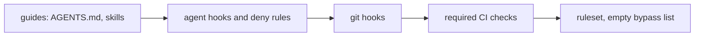

# Zero required approvals; every gate is a status check

A solo owner cannot approve their own PR, so a required approval would either block every merge or need a bypass. So the ruleset requires zero approvals and makes every gate a required status check (strict), with an empty bypass list: nobody, the owner included, merges past a red check. The owner's review is the decision to merge, and only the owner merges, because the agent deny rules forbid `gh pr merge` and pushes to `main`.

On a private repo on GitHub Free, GitHub does not enforce rulesets. Bootstrap detects the 403 and reports **honor mode**: CI still runs and reports, the agent deny rules still apply, and merging on red is the owner's manual choice.

