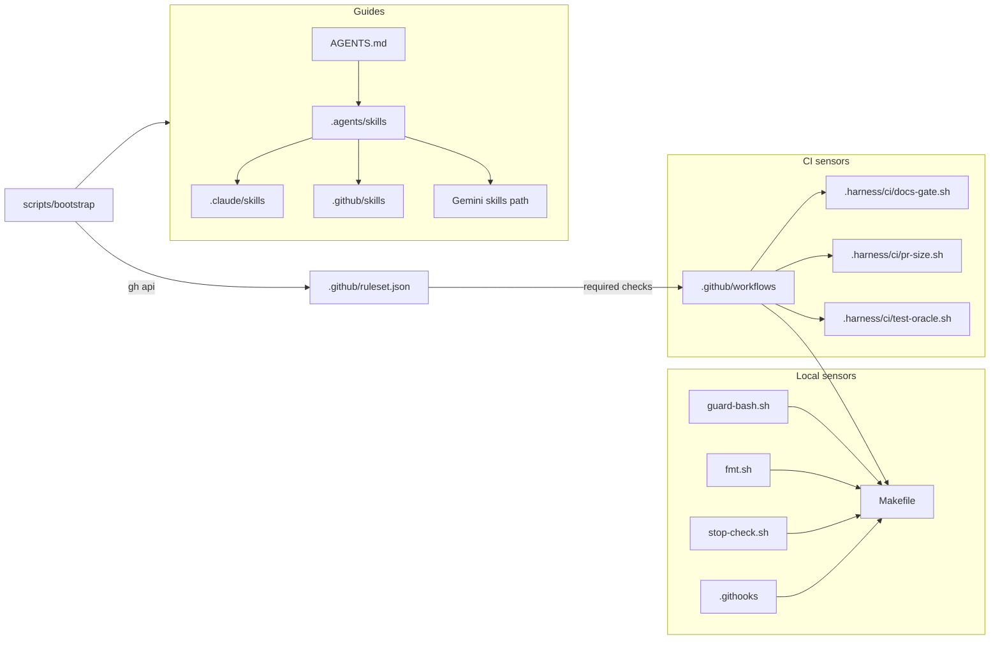
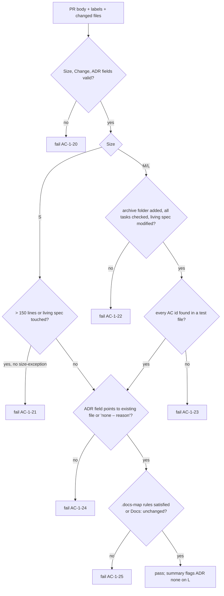
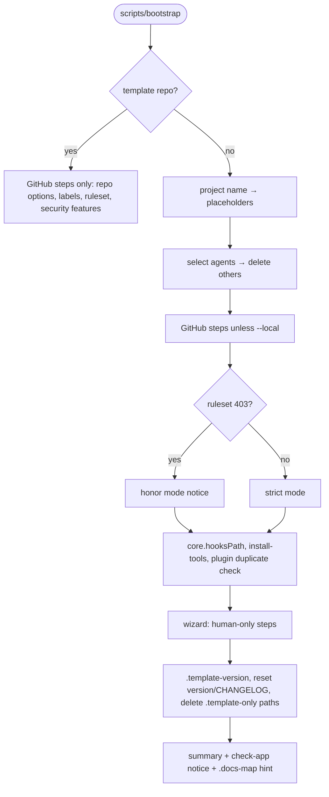

# Design: change 1 — bootstrap the `solo-harness` template

This document explains **how** the proposal is built. The proposal (`proposal.md`) stays the source of truth for **what**. Requirement and criterion IDs (`R…`, `AC-1-…`) refer to it.

## 1. Runtime dependencies

The harness must work on a fresh Linux or macOS machine and on `ubuntu-latest` runners.

| Dependency | Why | How it gets there |
|---|---|---|
| `bash` ≥ 4, `git`, `make` | Scripts, hooks, task runner | Assumed present |
| `python3` (stdlib only) | JSON/YAML-light parsing in scripts, `ste-lint.py` | Assumed present; no `pip install` |
| `gh` | Bootstrap GitHub steps, `--add-agent` | Assumed present; bootstrap checks `gh auth status` |
| `shellcheck`, `actionlint`, `gitleaks`, `osv-scanner` | Lints and scanners | Pinned binaries downloaded by `scripts/install-tools` into gitignored `.harness/bin/`, verified against SHA-256 values in `.harness/tools.lock` |
| `zizmor` | Workflow audit | CI only, through `zizmorcore/zizmor-action` pinned by SHA |

`jq` is deliberately not a dependency. `python3 -c` covers JSON parsing everywhere.

`make tools` runs `scripts/install-tools`. It is idempotent and a prerequisite of `check-harness`, so the first `make check` downloads the tools once. CI runs the same script, so local and CI versions always match. Updates follow R22: `install-tools --update` rewrites lines, and the monthly `tools-outdated` workflow reports stale pins. For testability, `install-tools` reads release metadata and downloads through two overridable functions, so tests feed it fixtures instead of the network (AC-1-37, AC-1-38).

## 2. Component map



## 3. Directory and script layout

```
Makefile                      # check, check-harness, check-app, fmt, tools, test-harness, vendor-diff, test-bootstrap
scripts/                      # only commands the owner runs directly
  bootstrap                   # R18
  install-tools               # installs pinned binaries into .harness/bin; --update <name|all> rewrites tools.lock
  vendor-diff                 # AC-1-7
.harness/                     # all harness internals; ships to every project
  config                      # shell-sourceable settings: HARNESS_PATHS, TEST_GLOBS, size limits
  tools.lock                  # name, version, url template, sha256 per OS/arch
  bin/                        # gitignored; pinned tool binaries
  lib/
    common.sh                 # logging, die, run-or-print (dry-run), repo-root, glob matching
  check/                      # one script per check-harness concern, each exits non-zero on failure
    symlinks.sh  agents-md.sh  skills-frontmatter.sh  change-folders.sh
    deny-rules.sh  markdown.sh (Mermaid fences, image embeds)
  ci/                         # CI gate logic; pure functions of (PR body file, changed files, labels)
    docs-gate.sh  pr-size.sh  test-oracle.sh
  tests/
    run.sh                    # plain-bash runner: sources each test_*.sh, runs every test_* function
    lib/assert.sh
    fixtures/                 # PR bodies, fake diffs, sample change folders
    test_*.sh                 # one file per capability
.claude/hooks/{guard-bash.sh,fmt.sh,stop-check.sh}
.template-only                # manifest of paths bootstrap deletes in a new project
```

`tests/`, `test/`, `src/` and every other root folder belong to the project. The harness never writes there.

**Why CI logic lives in `.harness/ci/` and not inline in workflow YAML:** the gates become testable locally with fixtures, the agent can run them before pushing, and zizmor has less inline shell to worry about.

## 4. Testing strategy

- `.harness/tests/run.sh` is a ~60-line runner, invoked by `make test-harness` (part of `check-harness`). Each test is a bash function named `test_<what>`. The first line of each test is a comment naming the criterion it covers, e.g. `# AC-1-35`. This is what `docs-gate` greps for (AC-1-23), so this change proves its own gate.
- Every criterion `AC-1-1` … `AC-1-39` has at least one test.
- Content criteria (e.g. AC-1-3, AC-1-10) are tested by asserting on required headings or lines, not on exact prose.
- CI gates are tested by calling `.harness/ci/*.sh` with fixtures: a PR body file, a list of changed files with line counts, and labels. The scripts take these as arguments or environment variables, never by calling the GitHub API themselves. The workflows gather the data and pass it in.
- Hooks are tested by piping the JSON Claude Code would send on stdin and asserting on the exit code and output.
- `make test-bootstrap` copies the repo to a temp dir with `cp -a`, runs `scripts/bootstrap --dry-run --local` and `--local` with scripted answers (`BOOTSTRAP_ANSWERS` env var), and asserts the resulting tree.

## 5. Harness boundary and test files

`.harness/config` is the single place for two path definitions. Every script sources it, so no two gates can disagree.

- **`HARNESS_PATHS`**: `.agents .claude .codex .gemini .github .githooks .harness .scratch docs specs scripts` plus root files (`*.md`, `Makefile`, `.docs-map`, `.template-*`, `version.txt`, release-please files, `LICENSE`, dotfiles). Any tracked file outside this set is **app source**. The placeholder `check-app` fails once app source exists (AC-1-16). A project that only adds `tests/test_api.py` therefore trips it too.
- **`TEST_GLOBS`**: `**/test_*.* **/*_test.* **/*.test.* **/*.spec.* tests/** test/** __tests__/** .harness/tests/**`. Overlays narrow it to their stack. Three consumers read it:
  - `docs-gate` searches only these files for `AC-<id>-<n>` (AC-1-23).
  - `test-oracle` treats a change to any matching file as a test change.
  - `check-app` counts matching files outside `.harness/` as app source.

`pr-size` has its own exclusions (lockfiles, `specs/changes/archive/`), also defined in `.harness/config`.

A filled `check-app` is detected by the absence of the marker line `# solo-harness:check-app-placeholder` in the Makefile. Bootstrap uses the same marker for AC-1-34.

## 6. Hooks

All three Claude hooks read the hook JSON from stdin with `python3`, and print nothing on success.

- **`guard-bash.sh`** normalizes the command (collapses whitespace, splits on `;`, `&&`, `||`, `|`) and matches each segment against a pattern list. Pocock's original covers `push --force`, `reset --hard` and similar; we add the AC-1-35 cases. Any parse error exits 2 (fail-closed).
- **`fmt.sh`** runs `make -s fmt FILE=<path>` and always exits 0. A formatter failure is not worth blocking an edit; `check` catches it.
- **`stop-check.sh`** follows R7. It reads `stop_hook_active` from the input and exits 0 when it is true, which prevents an infinite Stop loop.

Codex, Gemini and Copilot equivalents are written in task 5 after checking their current docs. Where an agent supports a "before shell command" hook, it reuses `guard-bash.sh` with a thin adapter for its input format.

## 7. Documentation gate



The script writes a Markdown summary to `$GITHUB_STEP_SUMMARY` when that variable is set, and to stdout otherwise.

## 8. Bootstrap



- **Template detection:** the file `.template-only` exists **and** `.template-version` does not. In template mode bootstrap never deletes or renames anything.
- **Idempotency:** every step first checks the current state (label exists, ruleset with the same name exists and matches, hooksPath already set, file already deleted) and prints `ok` or `changed`.
- **Dry run:** all mutating commands go through `run` in `common.sh`, which prints instead of executing when `DRY_RUN=1`.
- **`--add-agent`:** reads the template repo and version from `.template-version`, downloads that tag's tarball with `gh api`, and copies only that agent's paths.
- **Plugin duplicates:** reads `~/.claude/settings.json` `enabledPlugins` and the skill folder names inside each enabled plugin's cache directory. Any plugin with a skill name that matches a folder in `.agents/skills/` gets `"<plugin>": false` in the project's `.claude/settings.json`.

## 9. Ruleset and the first PR

GitHub requires a base commit before a PR can exist, and a ruleset can require checks that have never run. So the publish sequence is:

1. Initial commit on `main`: only `specs/changes/1-bootstrap-template/` (proposal, design, tasks). Pushed directly; no ruleset exists yet.
2. Branch `1-bootstrap-template` holds all implementation commits.
3. Run `scripts/bootstrap` in template mode: repo options, labels, ruleset. From now on `main` is protected.
4. Open PR #2 (issue #1 tracks the change). It needs the `size-exception` label, since vendored skills alone exceed 400 lines.
5. `finish` runs as the last commit of the PR. All required checks must pass before the owner squash-merges.
6. Mark the repo as a template in GitHub settings.

## 10. Risks

| Risk | Mitigation |
|---|---|
| Codex/Gemini/Copilot config formats differ from what research notes say | Task 5 verifies against current docs before writing; unsupported features are documented, not faked |
| Pinned tool download fails (network, moved URL) | `install-tools` fails with a clear message; `check-harness` cannot pass without tools, by design |
| `guard-bash.sh` false positives annoy daily use | Allowed-command tests (AC-1-35) and `retro` to tune patterns |
| Upstream skills change shape | Pinned SHAs; `vendor-diff` makes updates deliberate |
| Plugin cache layout changes | Duplicate detection warns and skips instead of failing |
