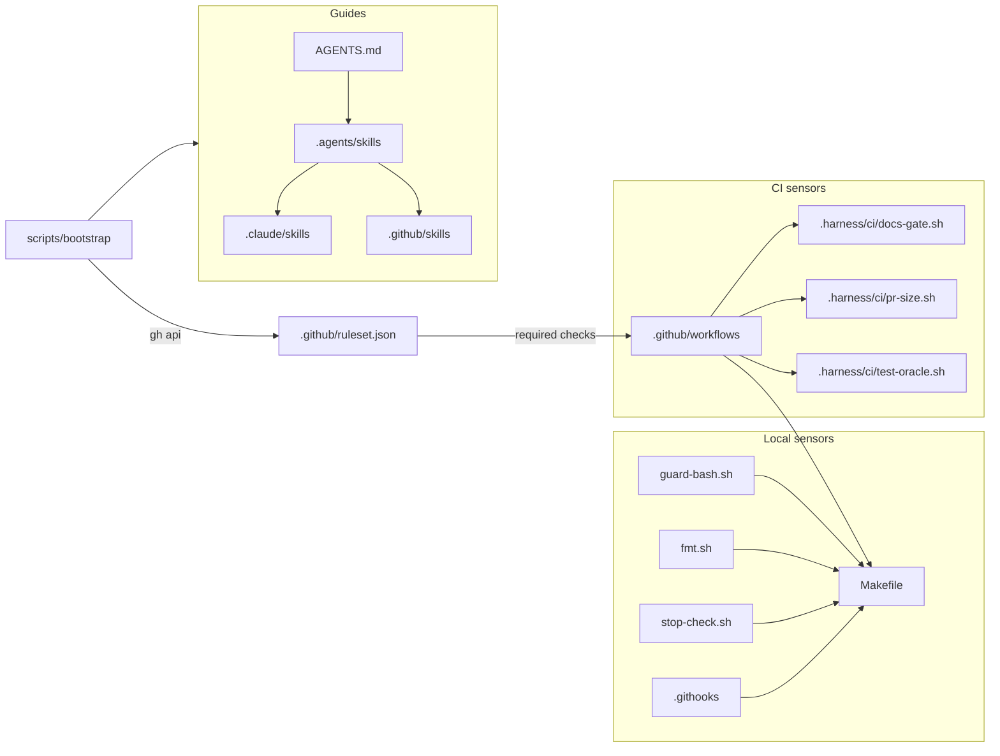
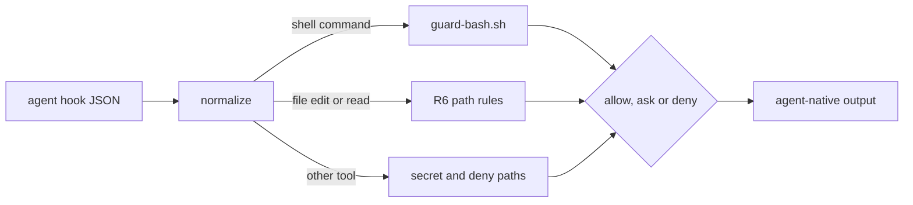
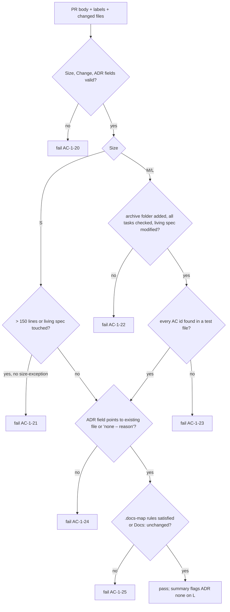
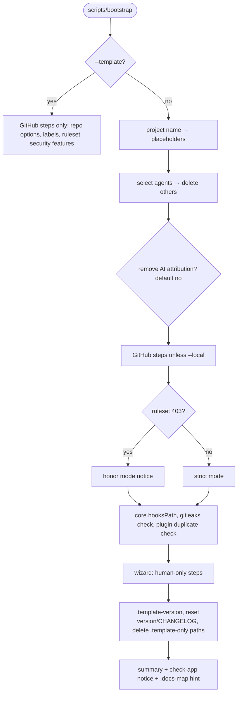

# Design: change 1 — bootstrap the `solo-harness` template

This document explains **how** the proposal is built. The proposal (`proposal.md`) stays the source of truth for **what**. Requirement and criterion IDs (`R…`, `AC-1-…`) refer to it.

## 1. Runtime dependencies

The harness must work on a fresh Linux or macOS machine and on `ubuntu-latest` runners.

| Dependency | Why | How it gets there |
|---|---|---|
| `bash` ≥ 4, `git`, `make` | Scripts, hooks, task runner | Assumed present |
| `python3` (stdlib only) | JSON/YAML-light parsing in scripts, `ste-lint.py` | Assumed present; no `pip install` |
| `gh` | Bootstrap GitHub steps, `--add-agent` | Assumed present; bootstrap reads the repo with `gh api` first and stops with a `gh auth login` hint if that fails |
| `shellcheck`, `actionlint`, `gitleaks`, `osv-scanner` | Lints and scanners | Pinned binaries downloaded by `scripts/install-tools` into gitignored `.harness/bin/`, verified against SHA-256 values in `.harness/tools.lock` |
| `zizmor` | Workflow audit | CI only, through `zizmorcore/zizmor-action` pinned by SHA |

`jq` is deliberately not a dependency. `python3 -c` covers JSON parsing everywhere.

`make tools` runs `scripts/install-tools`. It is idempotent and a prerequisite of `check-harness`, so the first `make check` downloads the tools once. CI runs the same script, so local and CI versions always match. Updates follow R22: `install-tools --update` rewrites lines, and the monthly `tools-outdated` workflow reports stale pins. For testability, `install-tools` reads release metadata and downloads through two overridable functions, so tests feed it fixtures instead of the network (AC-1-37, AC-1-38).

## 2. Component map



## 3. Directory and script layout

```
Makefile                      # check, check-harness, check-app, fmt, tools, test-harness, vendor-diff, test-bootstrap
scripts/                      # only commands the owner runs directly
  bootstrap                   # R18
  install-tools               # installs pinned binaries into .harness/bin; --update <name|all> rewrites tools.lock; --outdated lists stale pins
  vendor-diff                 # AC-1-7
.harness/                     # all harness internals; ships to every project
  config                      # shell-sourceable settings: HARNESS_PATHS, TEST_GLOBS, ORACLE_GLOBS, size limits
  tools.lock                  # name, version, url template, sha256 per OS/arch
  bin/                        # gitignored; pinned tool binaries
  lib/
    common.sh                 # logging, die, run-or-print (dry-run), repo-root, glob matching
  check/                      # one script per check-harness concern, each exits non-zero on failure
    symlinks.sh  agents-md.sh  skills-frontmatter.sh  change-folders.sh  vendored.sh
    deny-rules.sh  markdown.sh (Mermaid fences, image embeds)
  ci/                         # CI gate logic; pure functions of (PR body file, changed files, labels)
    docs-gate.sh  pr-size.sh  test-oracle.sh
  hooks/                      # agent hooks: guard-bash.sh, fmt.sh, stop-check.sh, adapter.sh
  tests/
    run.sh                    # plain-bash runner: sources each test_*.sh, runs every test_* function; TEST_FILES picks other files
    lib/assert.sh
    fixtures/                 # PR bodies, fake diffs, sample change folders
    test_*.sh                 # one file per capability
    bootstrap/test_*.sh       # make test-bootstrap: scripts/bootstrap on temp copies
.template-only                # manifest of paths bootstrap deletes in a new project
```

`tests/`, `test/`, `src/` and every other root folder belong to the project. The harness never writes there.

**Why CI logic lives in `.harness/ci/` and not inline in workflow YAML:** the gates become testable locally with fixtures, the agent can run them before pushing, and zizmor has less inline shell to worry about.

## 4. Testing strategy

- `.harness/tests/run.sh` is a ~60-line runner, invoked by `make test-harness` (part of `check-harness`). Each test is a bash function named `test_<what>`. The first line of each test is a comment naming the criterion it covers, e.g. `# AC-1-35`. This is what `docs-gate` greps for (AC-1-23), so this change proves its own gate.
- Every criterion `AC-1-1` … `AC-1-41` has at least one test.
- Content criteria (e.g. AC-1-3, AC-1-10) are tested by asserting on required headings or lines, not on exact prose.
- CI gates are tested by calling `.harness/ci/*.sh` with fixtures: a PR body file, a list of changed files with line counts, and labels. The scripts take these as arguments or environment variables, never by calling the GitHub API themselves. The workflows gather the data and pass it in: the changed files are a `git diff --numstat -z --no-renames` file given as the first argument (`-z` keeps unusual paths unquoted), and the labels are `PR_LABELS` (comma-separated). Shared input helpers live in `.harness/lib/common.sh`. The gate tests write their small numstat inputs inline; PR-body fixtures go in `.harness/tests/fixtures/`.
- Hooks are tested by piping the JSON Claude Code would send on stdin and asserting on the exit code and output.
- `make test-bootstrap` copies the repo to a temp dir with `cp -a`, runs `scripts/bootstrap --dry-run --local` and `--local` with scripted answers (`BOOTSTRAP_ANSWERS` env var), and asserts the resulting tree. The GitHub steps are tested the same way, with `gh_api` replaced by a fake that a sourced overrides file defines (`.harness/tests/lib/fake_gh.sh`). The fake answers from state files and logs every call, so a test can assert that a dry run makes no write.

## 5. Harness boundary and test files

`.harness/config` is the single place for the path definitions below. Every script sources it, so no two gates can disagree.

- **`HARNESS_PATHS`**: `.agents .claude .codex .github .githooks .harness .scratch docs specs scripts` plus root files (`*.md`, `Makefile`, `.docs-map`, `.template-*`, `version.txt`, release-please files, `LICENSE`, dotfiles). Any tracked file outside this set is **app source**. The placeholder `check-app` fails once app source exists (AC-1-16). A project that only adds `tests/test_api.py` therefore trips it too.
- **`TEST_GLOBS`**: `**/test_*.* **/*_test.* **/*.test.* **/*.spec.* tests/** test/** __tests__/** .harness/tests/**`. Overlays narrow it to their stack. Three consumers read it:
  - `docs-gate` searches only these files for `AC-<id>-<n>` (AC-1-23).
  - `test-oracle` treats a change to any matching file as a test change.
  - `check-app` counts matching files outside `.harness/` as app source.

- **`ORACLE_GLOBS`**: snapshots (`**/__snapshots__/**`, `**/*.snap`), workflows and actions under `.github/`, `.harness/ci/**`, `.harness/config`, `.harness/lib/**` and `.harness/tools.lock`. `test-oracle` treats a change to these files like a test change, because each one changes what counts as correct.

`pr-size` has its own exclusions (lockfiles, `specs/changes/archive/`), also defined in `.harness/config`.

A filled `check-app` is detected by the absence of the marker line `# solo-harness:check-app-placeholder` in the Makefile. Bootstrap uses the same marker for AC-1-34.

## 6. Hooks

All three Claude hooks read the hook JSON from stdin with `python3`, and print nothing on success.

- **`guard-bash.sh`** tokenizes the command with Python `shlex` (quotes respected) and splits it on `;`, `&&`, `||`, `|`, `&`, newlines and parentheses. A quote-aware pass runs first: it removes comments and heredoc bodies (data, not code) and turns unquoted newlines and backticks into separators. `$(…)` and backtick commands inside words, and `<(…)`, are checked recursively. It strips `VAR=value` prefixes (blocking any that set `core.hooksPath`, such as `GIT_CONFIG_KEY_0`), shell keywords (`{`, `if`, `then`, `do`, …), `function NAME` and wrapper commands with their options (`env`, `sudo`, `nice`, `timeout`, `xargs`, `nohup`, …), and checks the script of `bash -c`/`-lc`/`-xc` and `eval` recursively. Git accepts a unique prefix of a long option, so prefixes count too (`--no-veri`, `--har`, `--forc`). Each segment is matched by rules, not by regex on the raw string:
  - `git push`: force (`-f`, `--force*`, `+ref`), `--no-verify`, `--mirror`/`--all`, a destination of `main` (also `heads/main`, and with `--repo`), and `HEAD`, `@` or a bare push while the current branch is `main`. A push to a feature branch is allowed.
  - `git commit -n`/`--no-verify` (the value of `-m`, `-F` and similar options is skipped), `-c core.hooksPath=…`, and a `git config` write or unset of `core.hooksPath` to anything but exactly `.githooks` (a value pattern after the value counts as a write). Reads pass: `--get*`, `--list`/`-l`, `get`, `list` and a key alone.
  - `gh pr merge`, `gh release create`, `gh api …/merge` and GraphQL merge mutations (also after `-R <repo>`), and `curl`/`wget` piped into a shell.
  - From Pocock's original: `reset --hard`, `clean -f`, `branch -D`, `checkout .`, `restore .` (`restore --staged .` is allowed).
  - Reading `.env*` or `~/.ssh`, and shell writes (`>`, `>|`, `&>`, `sed -i`/`--in-place`, `tee`, `mv`, `rm`, `dd of=`, `patch`, `git checkout|restore|rm|mv`, …) to agent policy files, `.harness/hooks/`, `.harness/check/deny-rules.sh` and `.githooks/`, or to the folders that hold them. `.env.example` is blocked on purpose: it matches `.env*` in R6 and the `Read(./.env*)` deny rule, so the two layers agree.

  - Shell writes (same detection) to the R6 ask paths (`Makefile`, `.github/workflows/`, `CODEOWNERS`, `.harness/tools.lock`) are not blocked: the hook prints a `permissionDecision: "ask"` JSON object, so they get the same prompt as the `Edit(…)` ask rules.

  An unparsable command or hook input exits 2 (fail-closed).

  **Limit:** the guard reads the command text. It cannot see commands that the shell builds at run time: command substitution (`$(echo git) push`), variables (`g=git; $g push`), git aliases (`git -c alias.p=push p`), process substitution (`bash <(curl …)`), a download piped into an interpreter other than a shell (`curl … | python3`), literal text piped into a shell (`echo "git push" | bash`), or a file write by a general interpreter (`python3 -c`, `node -e`). It is a backstop for the deny rules, not a sandbox. The git hooks, CI and the ruleset are the layers that hold when it misses.
- **`fmt.sh`** runs `make -s fmt FILE=<path>` and always exits 0. Its matcher is `Edit|Write|MultiEdit`: `MultiEdit` is a third file-editing tool, so R7's `Edit|Write` would miss its edits. A formatter failure is not worth blocking an edit; `check` catches it.
- **`stop-check.sh`** follows R7. Claude Code has no `onFailure` setting: exit 2 is how a Stop hook blocks, and its stderr goes back to the agent. It reads `stop_hook_active` from the input and exits 0 when it is true, which prevents an infinite Stop loop.

### 6.1 Other agents: findings (checked 2026-11-12)

Task 5 checked each agent against its current official docs. Google replaced Gemini CLI with **Antigravity CLI** (`agy`) on 2026-06-18 for unpaid and Google One accounts ([blog](https://developers.googleblog.com/an-important-update-transitioning-gemini-cli-to-antigravity-cli/)). Gemini CLI's project-level policy tier is "currently non-functional" ([policy engine](https://geminicli.com/docs/reference/policy-engine/)). The owner chose Antigravity CLI as the fourth agent.

| Topic | Codex CLI | Copilot (CLI and cloud agent) | Antigravity CLI |
|---|---|---|---|
| Instructions | `AGENTS.md` | `AGENTS.md` (also `.github/copilot-instructions.md`) | `AGENTS.md` and `GEMINI.md` ([migration](https://antigravity.google/docs/cli/gcli-migration)) |
| Repo skills | `.agents/skills/` ([skills](https://learn.chatgpt.com/docs/build-skills)) | `.agents/skills/`, `.github/skills/` or `.claude/skills/` ([skills](https://docs.github.com/en/copilot/concepts/agents/about-agent-skills)) | `.agents/skills/` |
| Hooks file | `.codex/hooks.json` or `[hooks]` in `.codex/config.toml` ([hooks](https://learn.chatgpt.com/docs/hooks)) | `.github/hooks/*.json`, `version: 1`; cloud agent reads it from the default branch ([reference](https://docs.github.com/en/copilot/reference/hooks-reference)) | `.agents/hooks.json` ([hooks](https://antigravity.google/docs/hooks/)) |
| Before-tool event | `PreToolUse`; `tool_name` `Bash` or `apply_patch`, text in `tool_input.command` | `preToolUse`; `toolName` `bash` or `edit`, `toolArgs` is a JSON string (`{"command": …}`) | `PreToolUse`; `toolCall.name` `run_command` (`toolCall.args.CommandLine`) or `write_to_file`, `replace_file_content`, `multi_replace_file_content` |
| How to block | exit 2, or `permissionDecision: "deny"` | exit 2, or `permissionDecision: "deny"`; other non-zero exits also deny | JSON `decision: "deny"` (exit codes not documented) |
| Ask | Not supported: the hook run fails and the call continues | `"ask"`; the cloud agent treats it as deny | `"ask"` and `"force_ask"` |
| Stop event | `Stop`: exit 2 or `decision: "block"` starts a continuation | `agentStop`: `block` forces another turn (CLI stops after 8) | `Stop`: `decision: "continue"` with a `reason` |
| After-tool event | `PostToolUse` | `postToolUse` | `PostToolUse` |
| Permission policy in the repo | `.codex/rules/*.rules` (`prefix_rule`, `forbidden`/`prompt`/`allow`) for commands ([rules](https://learn.chatgpt.com/docs/agent-configuration/rules)). Path rules exist in permission profiles, but the docs show them only in user and system config ([permissions](https://learn.chatgpt.com/docs/permissions)). | None. Tools are limited per custom agent (`tools:`). | None. Allow/ask/deny rules are only in the global `~/.gemini/antigravity-cli/settings.json` ([permissions](https://antigravity.google/docs/permissions/)). |
| Trust | Project `.codex/` hooks and rules load only in a trusted project, and each hook must be trusted (by hash) with `/hooks` | None documented | `trustedWorkspaces`; the docs do not say whether `.agents/hooks.json` needs trust |
| Built-in protection | The `:workspace` sandbox keeps `.git`, `.agents` and `.codex` read-only | None | None documented |
| Read-only reviewer agent | None | `.github/agents/reviewer.agent.md` with `tools: ["read", "search"]` | None |

**Gaps.** Copilot and Antigravity cannot keep R6 rules in the repo, so the hooks are the only in-repo layer there. Codex hooks cannot ask, so the R6 ask paths become deny for Codex or rely on its approval policy. Each project hook needs a trust step by the owner, so `bootstrap` prints it as a human step. Where a hook misses, the git hooks, CI and the ruleset hold.

**Not done on purpose.** `.codex/rules/default.rules` has no R6 allow rules: a Codex `allow` rule runs the command outside the sandbox, and the `:workspace` sandbox already runs `make`, read-only `git` and `gh` without a prompt. Copilot and Antigravity get the R6 package-install ask from the adapter (`PACKAGE_INSTALL` in `policy.py`); Claude and Codex get it from their own rules. If `python3` is missing, the adapter cannot run: Copilot denies the call (non-zero exit), Codex and Antigravity let it through. `python3` is a harness requirement, so `make check` fails first.

### 6.2 Adapter

`.harness/hooks/adapter.sh AGENT EVENT` connects Codex, Copilot and Antigravity to the three hook scripts. `AGENT` is `codex`, `copilot` or `antigravity`. `EVENT` is `pre`, `post` or `stop`. It reads the agent's hook JSON from stdin.



- **Shared rules.** `.harness/hooks/policy.py` holds the R6 path patterns. `guard-bash.sh` and the adapter both import it. Each pattern also tests the cleaned path (`os.path.normpath`), so `a//b`, `a/./b` and `x/../a` do not get past a rule.
- **`pre`, shell command** (Codex `Bash`, Copilot `bash`, Antigravity `run_command`): the adapter sends `{"tool_input": {"command": …}}` to `guard-bash.sh`. Exit 2 is deny with the stderr reason. An `"ask"` JSON result is ask.
- **`pre`, file edit** (Codex `apply_patch`: paths from the `*** Add/Update/Delete File:` and `*** Move to:` lines; Copilot `edit`/`create`; Antigravity `write_to_file`, `replace_file_content`, `multi_replace_file_content` with `TargetFile`): a path that matches an R6 deny path is deny. A path that matches an R6 ask path is ask. The path rules come from `policy.py`, so the two do not drift.
- **`pre`, file read** (Copilot `view`, Antigravity `view_file` with `AbsolutePath`): a path that matches `.env*` or `.ssh/` is deny.
- **Unknown argument keys.** Copilot does not document the `toolArgs` keys of `edit`, `create` and `view`. The adapter checks every string value under a key that ends in `path` or `file` (so `file_text` is not a path). An edit or read tool with no such value is deny (fail-closed).
- **`pre`, other tool** (any tool the adapter does not know, for example Copilot `glob` or `grep`): the adapter cannot tell which arguments are paths, so it checks every string in the arguments. A string that matches a secret path or an R6 deny path is deny. All other calls are allow.
- **Package install.** The adapter asks for Copilot and Antigravity only. For Codex the hook lets the install through, so the `prompt` rule in `.codex/rules/default.rules` can ask.
- **Output.** Codex: deny is exit 2 with the reason on stderr; ask becomes deny with "ask the owner" in the reason, because Codex hooks cannot ask. Copilot: `{"permissionDecision": …, "permissionDecisionReason": …}`; allow prints nothing. Antigravity: `{"decision": "allow"|"ask"|"deny", "reason": …}`, because `decision` is required.
- **`post`**: runs `fmt.sh` once per edited path. Always exits 0. Antigravity gets `{}`. Copilot has no `post` hook (R7).
- **`stop`**: runs `stop-check.sh`. Codex passes its `stop_hook_active`. Antigravity has no loop flag, so the adapter sends `false`. On failure, Codex gets exit 2 with the reason on stderr and Antigravity gets `{"decision": "continue", "reason": …}`. On success, Codex gets `{}` and Antigravity gets `{"decision": "allow"}`.
- **Not verified in a live session:** Antigravity exit codes and the hook working directory, and the Copilot `toolArgs` keys. The owner smoke-tests each agent later and opens a new change for each fix.

## 7. Documentation gate



The script writes a Markdown summary to `$GITHUB_STEP_SUMMARY` when that variable is set, and to stdout otherwise.

## 8. Bootstrap



- **Template mode:** only with the flag `--template`. A repo made with "Use this template" has the same files as the template, so file checks cannot tell the two apart. Without the flag, a missing `.template-version` means a first project run, and a present one means a re-run. In template mode bootstrap never deletes or renames anything.
- **Idempotency:** every step first checks the current state (label exists, ruleset with the same name exists and matches, hooksPath already set, file already deleted) and prints `ok` or `changed`.
- **Dry run:** all mutating local commands go through `run` in `common.sh`, which prints instead of executing when `DRY_RUN=1`. GitHub calls go through `gh_read` and `gh_write` in `scripts/bootstrap`: a dry run prints both, does the reads and skips the writes.
- **`--add-agent`:** reads the template repo and version from `.template-version`, downloads that tag's tarball with `gh api`, and copies only that agent's paths.
- **AI attribution:** one yes/no question, default no (keep). On yes, bootstrap writes the "no attribution" setting into each selected agent's project config that supports one; for Claude Code that is the attribution setting in `.claude/settings.json` (commit and PR text set to empty). Agents without such a setting are named in the summary. Checked on 2026-11-13: Claude Code `attribution: {"commit": "", "pr": "", "sessionUrl": false}` in `.claude/settings.json` (this form also works in versions before `attribution: false`); Copilot CLI `includeCoAuthoredBy: false` in `.github/copilot/settings.json` (a repo-overridable key); Codex has no repo setting (`commit_attribution` was removed); Antigravity documents none. Template mode never asks, so this repo keeps its `Co-Authored-By` trailers. `BOOTSTRAP_ANSWERS` carries the answer in tests.
- **Plugin duplicates:** reads `~/.claude/settings.json` `enabledPlugins` and the skill folder names inside each enabled plugin's cache directory. Any plugin with a skill name that matches a folder in `.agents/skills/` gets `"<plugin>": false` in the project's `.claude/settings.json`.

## 9. Ruleset and the first PR

GitHub requires a base commit before a PR can exist, and a ruleset can require checks that have never run. So the publish sequence is:

1. Initial commit on `main`: only `specs/changes/1-bootstrap-template/` (proposal, design, tasks). Pushed directly; no ruleset exists yet.
2. Branch `1-bootstrap-template` holds all implementation commits.
3. Run `scripts/bootstrap` in template mode: repo options, labels, ruleset. From now on `main` is protected.
4. Open PR #2 (issue #1 tracks the change). It needs the `size-exception` label, since vendored skills alone exceed 400 lines.
5. `finish` runs as the last commit of the PR. All required checks must pass before the owner squash-merges.
6. Mark the repo as a template in GitHub settings.

**The release PR.** The ruleset also applies to the PR that release-please opens (R16). Two things make that PR mergeable:

- `release-please-config.json` sets `pull-request-footer` to `Size: S`, `Change: none` and `ADR: none – …`, so `docs-gate` passes.
- A PR made with `github.token` does not start workflows, so the required checks never report. The workflow uses `secrets.RELEASE_PLEASE_TOKEN || github.token`. If the owner sets that secret (fine-grained PAT, contents and pull requests write), CI runs on its own. Without it, the owner closes and reopens the release PR before the merge. Bootstrap prints this as a human step.

## 10. Risks

| Risk | Mitigation |
|---|---|
| Codex/Antigravity/Copilot config formats differ from what research notes say | Task 5 verifies against current docs before writing; unsupported features are documented, not faked |
| Pinned tool download fails (network, moved URL) | `install-tools` fails with a clear message; `check-harness` cannot pass without tools, by design |
| `guard-bash.sh` false positives annoy daily use | Allowed-command tests (AC-1-35) and `retro` to tune patterns |
| Upstream skills change shape | Pinned SHAs; `vendor-diff` makes updates deliberate |
| Plugin cache layout changes | Duplicate detection warns and skips instead of failing |
