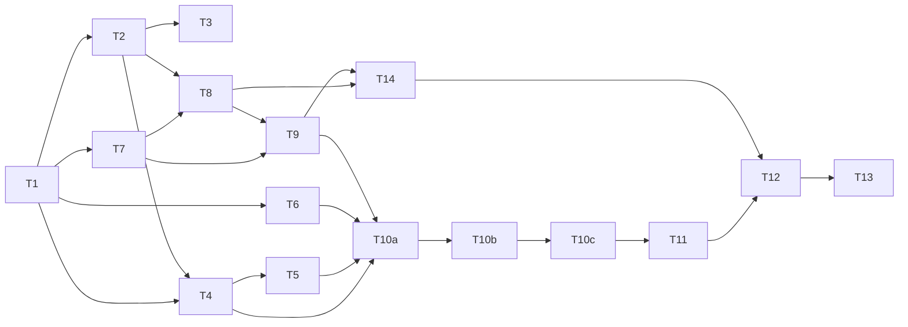

# Tasks: change 1 — bootstrap the `solo-harness` template

Each ticket is sized for one fresh context window. Work the **frontier**: any ticket whose blockers are done. Each ticket ends with `make check` green and one or more Conventional Commits on branch `1-bootstrap-template`. Each criterion is ticked only when a test that names it passes.

## T1: Skeleton, tools and `check-harness` core

**Delivers:** a repo where `make check` runs real harness checks with pinned tools and a plain-bash test runner.

**Blocked by:** none (cold start, built by hand).

- [x] `AGENTS.md`, `CLAUDE.md`/`GEMINI.md` symlinks, `docs/{product,architecture}.md` (architecture with a Mermaid skeleton), `docs/adr/`, `GLOSSARY.md`, `specs/`, `.gitignore`, `LICENSE` (MIT), `.template-only`
- [x] `.harness/tools.lock`, `scripts/install-tools` (install + `--update`), `make tools`
- [x] AC-1-37 hash mismatch deletes the file and fails
- [x] AC-1-38 `--update` rewrites only the named tool's lines with correct hashes
- [x] `.harness/config` (`HARNESS_PATHS`, `TEST_GLOBS`, size limits), `.harness/lib/common.sh`, `.harness/tests/run.sh`, `.harness/tests/lib/assert.sh`
- [x] `Makefile` with `check`, `check-harness`, `check-app` (placeholder marker), `fmt` (no-op), `test-harness`
- [x] `.harness/check/{symlinks,agents-md,skills-frontmatter,change-folders,markdown}.sh` and shellcheck/actionlint wiring
- [x] AC-1-1 symlinks resolve
- [x] AC-1-2 `AGENTS.md` ≤ 60 lines
- [x] AC-1-3 `AGENTS.md` content (check command, S/M/L, skills pointer, no ALL-CAPS)
- [x] AC-1-41 `AGENTS.md` code-review rule (once per ticket and PR, never skipped, no repeat unless asked)
- [x] AC-1-4 model advice present, no model pinned in any agent config
- [x] AC-1-8 skill frontmatter validation (tested with fixture skills)
- [x] AC-1-15 `make check` passes with no app source
- [x] AC-1-16 `make check` fails with `src/main.py` and the placeholder; also with only `tests/test_api.py`
- [x] AC-1-31 unterminated Mermaid fence fails
- [x] AC-1-33 embedded image under `docs/`/`specs/` fails

## T2: Vendor skills and license notices

**Delivers:** all third-party skills present at pinned commits, patched where the proposal says, with provenance and licenses.

**Blocked by:** T1.

- [x] Copy the 15 Pocock skills (incl. `grilling`, which `grill-with-docs` calls) and `asd-ste100` into `.agents/skills/`; `.claude/skills` and `.github/skills` symlinks
- [x] Patches: `to-spec`, `to-tickets`, `pr`, `handoff`, tracker-setup references, `domain-modeling` (Mermaid), `code-review` (docs-drift rule)
- [x] `VENDORED.md`, `THIRD_PARTY_LICENSES.md`, `scripts/vendor-diff`, `make vendor-diff`
- [x] AC-1-5 `VENDORED.md` has a complete row per skill
- [x] AC-1-6 MIT notices and modified-skill list present
- [x] AC-1-7 `vendor-diff` prints diffs and writes nothing
- [x] AC-1-9 side-effecting skills have `disable-model-invocation: true`
- [x] AC-1-26 `code-review` standards axis contains the docs-drift rule
- [x] AC-1-32 (skills part) `to-spec` and `domain-modeling` instruct Mermaid diagrams

## T3: `finish` skill

**Delivers:** the original skill that closes an M/L change inside its PR.

**Blocked by:** T2.

- [x] `.agents/skills/finish/SKILL.md` with the five R3 steps, Mermaid instruction for ADRs, `disable-model-invocation: true`
- [x] AC-1-10 `finish` exists and has the five steps
- [x] AC-1-32 (finish part) ADR step instructs Mermaid diagrams

## T4: Claude configuration and hooks

**Delivers:** Claude Code that cannot merge, push to `main`, loosen its own guardrails, or stop while `check` is red.

**Blocked by:** T1, T2.

- [x] `.claude/settings.json`: R6 deny/ask/allow (incl. ask on `.harness/tools.lock`), hooks registration, sandbox off
- [x] `.claude/hooks/{guard-bash,fmt,stop-check}.sh` (moved to `.harness/hooks/` in T5) (guard derived from Pocock's `git-guardrails-claude-code`, recorded in `VENDORED.md`)
- [x] `.claude/agents/reviewer.md` (read-only tools)
- [x] `.harness/check/deny-rules.sh`
- [x] AC-1-12 deny-rule presence check
- [x] AC-1-13 Stop hook no-op on clean tree
- [x] AC-1-14 Stop hook exits 2 with ≤ 40 lines on failing check
- [x] AC-1-35 guard blocks the eight listed commands, allows the two safe ones
- [x] AC-1-36 `fmt.sh` silent no-op

## T5: Codex, Copilot and Antigravity configuration

**Delivers:** the same policy and skills for the other three agents, as far as each supports it.

**Blocked by:** T4.

- [x] Check each agent's current docs for instruction file, skills path, permission/sandbox config and hooks; record findings in `design.md` §6.1
- [x] Owner moves `.claude/hooks/` to `.harness/hooks/` and updates `.claude/settings.json` (R7)
- [x] Remove `GEMINI.md` and `.gemini` from `HARNESS_DIRS`, the guard and the checks
- [x] `.harness/hooks/adapter.sh`: one adapter for Codex, Copilot and Antigravity; the guard also checks file edits against the R6 paths
- [x] Codex: `.codex/hooks.json` (guard, fmt, stop) and `.codex/rules/default.rules`
- [x] Copilot: `.github/copilot-instructions.md` pointer, `.github/agents/reviewer.agent.md`, `copilot-setup-steps.yml`, `.github/hooks/guard.json` (guard only)
- [x] Antigravity: `.agents/hooks.json` (guard, fmt, stop)
- [x] AC-1-12 per agent: Codex rules contain the deny commands; each hook file runs the guard
- [x] Extend AC-1-1 and AC-1-4 tests to the new files

## T6: Git hooks

**Delivers:** local commits that run `check`, scan for secrets and enforce Conventional Commits.

**Blocked by:** T1.

- [x] `.githooks/pre-commit`, `.githooks/commit-msg`
- [x] AC-1-18 pre-commit runs `check` and gitleaks; warns when gitleaks is missing
- [x] AC-1-19 commit-msg rejects non-Conventional messages
- [x] `guard-bash.sh` lets read-only `git config --get core.hooksPath` (and `--get-all`, `--list`) through; today line 231 blocks every `core.hooksPath` read whose last argument is not `.githooks`

## T7: CI workflows

**Delivers:** the required status checks, pinned and least-privilege.

**Blocked by:** T1.

- [x] `.github/workflows/ci.yml` with jobs `check`, `pr-title`, `zizmor`, `secrets`, `deps` (public/private switch), `pr-size`, `test-oracle`, `ste-lint` (non-blocking)
- [x] `.harness/ci/{pr-size,test-oracle}.sh` with fixture tests; test-oracle reads `TEST_GLOBS` and also trips on `.harness/tools.lock`
- [x] `.github/workflows/tools-outdated.yml` (monthly, report-only)
- [x] AC-1-39 `tools-outdated` permissions and triggers
- [x] All actions pinned to SHAs; job-level `permissions:`; no `pull_request_target`
- [x] AC-1-11 `ste-lint` job is non-blocking
- [x] AC-1-17 the `check` job runs `make check`; in the template `check-app` passes (no app source)
- [x] Tests for pr-size (400 lines, exclusions, `size-exception`) and test-oracle (fails without `specs/` change)

## T8: Documentation gate, PR and issue templates

**Delivers:** `docs-gate` enforcing R13, and the templates that feed it.

**Blocked by:** T2, T7.

- [x] `.harness/ci/docs-gate.sh` (AC search limited to `TEST_GLOBS`), `docs-gate` job, `.docs-map` (empty, with format comment)
- [x] `.github/PULL_REQUEST_TEMPLATE.md`, issue forms "Change request" and "Bug"
- [x] AC-1-20 missing/invalid fields fail
- [x] AC-1-21 S PR over 150 lines or touching a living spec fails without `size-exception`
- [x] AC-1-22 M/L PR without archive, with unchecked tasks or without living-spec change fails
- [x] AC-1-23 uncovered AC id fails
- [x] AC-1-24 missing ADR file fails; `none` on L is flagged
- [x] AC-1-25 `.docs-map` rule enforcement and `Docs: unchanged` escape

## T9: Ruleset, release and dependencies

**Delivers:** the governance and release files bootstrap applies.

**Blocked by:** T7, T8.

- [x] `.github/ruleset.json` (R14; check names match T7/T8 job names; empty bypass list)
- [x] `release-please-config.json`, `.release-please-manifest.json`, `version.txt` (`0.1.0`), `CHANGELOG.md`, release-please workflow
- [x] `.github/dependabot.yml` (github-actions, weekly, 3-day cooldown, grouped)
- [x] Test: every required check name in the ruleset exists as a job name in the workflows

## T10a: Bootstrap, local project mode

**Delivers:** `scripts/bootstrap` local steps (R18 steps 1–3, 7, 8, 10, 11) with `--dry-run` and `--local`, and `make test-bootstrap`.

**Blocked by:** T4, T5, T6, T9.

- [x] Project name (written as the title of `docs/product.md`), agent selection and deletion, AI-attribution question (default keep), `core.hooksPath` and gitleaks check, plugin duplicate check, `.template-version`, version/CHANGELOG reset, `.template-only` cleanup, final summary
- [x] Agent-specific harness tests return early when that agent's config is absent; a claude-only copy passes `check-harness`
- [x] `make test-bootstrap` wired into `check-harness`
- [x] AC-1-27 second dry run reports no changes
- [x] AC-1-28 each single-agent selection and all-four keep only the right files; symlinks resolve
- [x] AC-1-30 `test-bootstrap` runs these in plain bash inside `check-harness`
- [x] AC-1-34 `check-app` notice shown only for the placeholder
- [x] AC-1-40 "remove attribution" turns it off in `.claude/settings.json`; default and template mode write nothing

## T10b: Bootstrap, GitHub steps and template mode

**Delivers:** R18 steps 4–6 and 9, R15 strict/honor detection, template mode.

**Blocked by:** T10a.

- [ ] Template mode (GitHub steps only, never deletes or renames), repo options, labels, ruleset create-or-update by name, honor mode on 403, CodeQL and push protection on public repos, wizard-style human steps
- [ ] Every `gh api` call checked against current GitHub docs; tests replace `gh_api` through a sourced overrides file
- [ ] AC-1-29 dry run prints every `gh api` call and writes nothing remotely

## T10c: Bootstrap `--add-agent`

**Delivers:** `--add-agent <name>` (R18 flags, design §8).

**Blocked by:** T10b.

- [ ] Bootstrap also writes the template repo into `.template-version` (T10a writes only `version` and `agents`)
- [ ] Reads repo and version from `.template-version`, downloads that tag's tarball with `gh api`, copies only that agent's paths; tested through the `gh_api` seam

## T11: README

**Delivers:** the pipeline explained in detail, with Mermaid diagrams.

**Blocked by:** T10c.

- [ ] Sections from R20: quick start, lifecycle and S/M/L (diagram), enforcement layers (diagram), bootstrap flow (diagram), strict vs honor mode, sandbox, overlays (docstrings on public API only), recommended skills not included, plugin duplicates, deferred decisions
- [ ] Template-only README sections between markers; `scripts/bootstrap` deletes them in project mode (R18 step 10)
- [ ] AC-1-32 (AGENTS.md part) Mermaid rule line present in `AGENTS.md`
- [ ] Test: README contains every R20 section heading

## T12: Publish

**Delivers:** the public GitHub repo with the change open as a gated PR. **Each step that touches GitHub needs the owner's go-ahead.**

**Blocked by:** T11, T14.

- [ ] Create public repo `solo-harness`; push the spec-only initial commit to `main`
- [ ] Create issue #1; push branch `1-bootstrap-template`
- [ ] Run bootstrap in template mode (ruleset, labels, options, CodeQL, push protection)
- [ ] Open the PR with `size-exception`; all required checks run

## T13: Finish

**Delivers:** change 1 archived into living specs, ADRs written, PR mergeable.

**Blocked by:** T12.

- [ ] Run `finish`: verify, write living `specs/<capability>.md` files from R1–R21, archive to `specs/changes/archive/YYYY-MM-DD-1-bootstrap-template/`, ADRs for the nine decisions (owner confirms each)
- [ ] All required checks green, including `docs-gate` on this PR
- [ ] Owner squash-merges; mark the repo as a template
- [ ] Remind the owner about the deferred signed-commits change

## T14: Dependabot PRs pass the gates

**Delivers:** Dependabot PRs that can merge under the R14 ruleset. Found in the T9 review: they fail `docs-gate` (no `Size`/`Change`/`ADR` fields) and `test-oracle` (they change workflows without a `specs/` change). `pr-title` already passes through the `chore(deps)` commit prefix.

**Blocked by:** T8, T9.

- [ ] `docs-gate` and `test-oracle` pass when the PR author is `dependabot[bot]` and the PR changes only `uses:` pins in `.github/workflows/`; any other change still runs the full gate
- [ ] Tests for both scripts: Dependabot pin-only PR passes; Dependabot PR with other changes and a human PR with the same diff still fail
- [ ] Record the exemption in `design.md` §7
