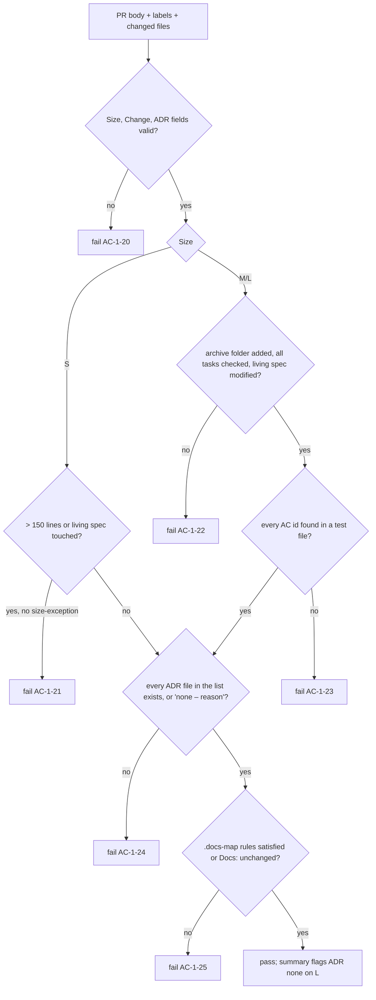

# Verification and enforcement

Only exit codes enforce. Each layer below fails with a non-zero exit; prompts only guide.

## Single `check` (R10)

`make check` = `check-harness` + `check-app`.

- `check-harness`: shellcheck on all shell scripts; actionlint on workflows; skill frontmatter validation; `VENDORED.md` and license-notice completeness (AC-1-5, AC-1-6); symlink integrity; `AGENTS.md` length; change-folder structure lint; deny-rule presence; hook tests (AC-1-13, AC-1-14, AC-1-35, AC-1-36); `test-bootstrap`.
- `check-app`: placeholder filled by the project or an overlay. Prints `no app checks configured`. Passes while no app source exists (any file outside the harness paths in `.harness/config`); fails once any does.
- `fmt`: no-op in the core, accepts `FILE=<path>`; overlays fill it (prettier, ruff format, …).

- **AC-1-15** GIVEN no app source WHEN `make check` runs THEN it passes.
- **AC-1-16** GIVEN a file `src/main.py` and the placeholder `check-app` WHEN `make check` runs THEN it fails with `no app checks configured`.
- **AC-1-17** GIVEN the template repo WHEN CI's `check` job runs `make check` THEN `check-app` passes because no app source exists.

## Git hooks (R11)

Git hooks are plain shell in `.githooks/`, activated with `git config core.hooksPath .githooks`.

- **AC-1-18** pre-commit runs `make check` and `gitleaks git --staged`. If gitleaks is not installed, it warns and continues.
- **AC-1-19** commit-msg rejects messages that are not Conventional Commits.

## CI workflows (R12)

All actions are pinned to full SHAs. Every job sets least-privilege `permissions:`. No workflow uses `pull_request_target`.

| Job | Behaviour | Required? |
|---|---|---|
| `check` | `make check` | Yes |
| `pr-title` | Conventional Commit title (`amannn/action-semantic-pull-request`) | Yes |
| `zizmor` | Workflow security audit | Yes |
| `secrets` | gitleaks binary on the PR commits | Yes |
| `deps` | `dependency-review-action` on public repos; `osv-scanner` on private repos | Yes |
| `docs-gate` | See below | Yes |
| `pr-size` | Fails over 400 changed lines (excluding lockfiles and `specs/changes/archive/`) unless label `size-exception` | Yes |
| `test-oracle` | Fails if tests, snapshots, workflows, CI config or `.harness/tools.lock` change and the PR does not touch `specs/` | Yes |
| `ste-lint` | Lints the PR body (see `skills.md`, AC-1-11) | No |
| `tools-outdated` | Separate monthly scheduled workflow (see `pinned-tools.md`) | No |
| CodeQL, push protection | Enabled by bootstrap on public repos only | — |

## Documentation gate (R13)

`docs-gate` parses these PR-body fields: `Size: S|M|L`, `Change: specs/changes/<id>-<slug>|none`, `ADR: docs/adr/<file>[, docs/adr/<file>…]|none – <reason>` (a comma-separated list when the change records more than one ADR), `Docs: unchanged – <reason>` (optional). It writes a Markdown summary to `$GITHUB_STEP_SUMMARY` when that variable is set, and to stdout otherwise.

- **AC-1-20** Missing or invalid `Size`/`Change`/`ADR` fields fail the job.
- **AC-1-21** An S PR fails if it exceeds 150 changed lines (excluding lockfiles) or modifies `specs/<capability>.md`, unless labelled `size-exception`.
- **AC-1-22** An M/L PR fails unless it adds `specs/changes/archive/YYYY-MM-DD-<id>-<slug>/` with `proposal.md` and `tasks.md` (plus `design.md` for L), the archived `tasks.md` has no unchecked `- [ ]`, and at least one `specs/<capability>.md` is modified.
- **AC-1-23** An M/L PR fails if any `AC-<id>-<n>` in its proposal is not found in a test file.
- **AC-1-24** `ADR:` pointing to a file fails if that file does not exist. `ADR: none` on an L PR passes but is flagged in the job summary.
- **AC-1-25** For each `.docs-map` rule (`<glob> -> <doc path>`), a PR that touches the glob but not the doc fails unless it has a `Docs: unchanged – <reason>` line. `.docs-map` ships empty.
- **AC-1-26** The `code-review` standards reviewer has the rule: user-visible behaviour, configuration, CLI flags or architecture changed → matching doc changed, or the PR says why not.

### Dependabot pin-only PRs

A Dependabot PR has no `Size`/`Change`/`ADR` fields and changes workflows without a `specs/` change. `docs-gate` and `test-oracle` pass it when `dependabot_pin_only` in `.harness/lib/common.sh` is true: the PR author is `dependabot[bot]`, every changed file is in `.github/workflows/`, and the diff changes only `uses:` lines. In each hunk the n-th removed line and the n-th added line are the same up to the `@` (indent, step marker, action), and the new ref is a full commit SHA. A new, deleted or renamed file, any other changed line, a moved, swapped or re-indented step, a different action, a ref that is not a SHA, or a missing diff file runs the full gate. A commit that a person adds to a Dependabot branch is in the diff, so it gets the full gate too. `pr-title` needs no exemption: Dependabot titles start with `chore(deps)`.

## Ruleset (R14)

`.github/ruleset.json` targets the default branch (`~DEFAULT_BRANCH`, which is `main`): PR required, zero required approvals, required status checks from R12 (strict), linear history, squash merge only, required review-thread resolution, an **empty bypass list**, force-push and deletion blocked. Signed commits are not required.

## Strict and honor mode (R15)

Bootstrap applies the ruleset. If GitHub returns 403 (private repo on GitHub Free), bootstrap prints that the repo runs in **honor mode**: CI still runs and reports, the agent deny rules still forbid merging and pushing to `main`, and merging is the owner's manual decision.
